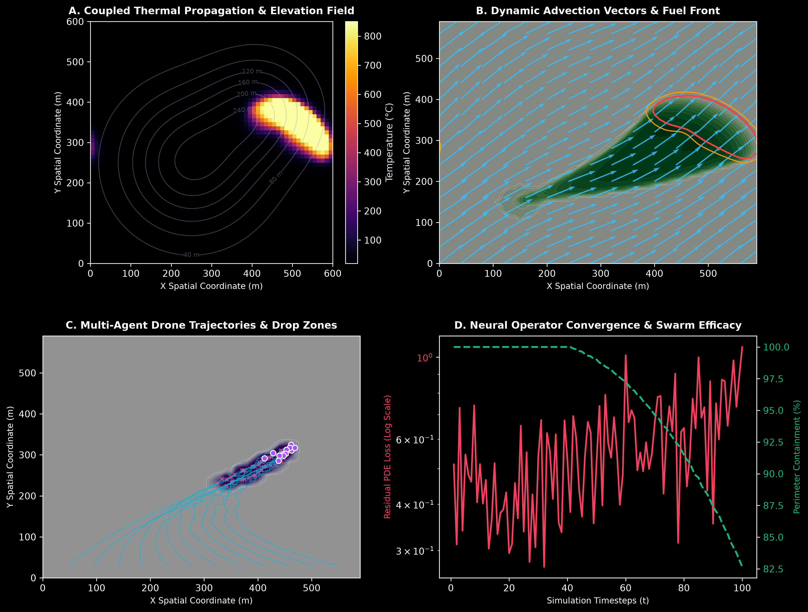

# AeroPyre-Sim: Physics-Informed Neural Operator & Autonomous Drone Swarm Wildfire Defense

[](https://www.python.org/downloads/)
[](https://opensource.org/licenses/MIT)
[](https://github.com/psf/black)

AeroPyre-Sim is a high-fidelity simulation engine that couples **Physics-Informed Neural Networks (PINNs)** with a **Decentralized Multi-Agent UAV Swarm** to predict, track, and suppress wildfire propagation fronts across complex 3D topological terrains under non-linear atmospheric wind fields.

---

## Problem Statement

Wildfires are escalating in frequency, intensity, and speed due to global climatic shifts, consuming tens of millions of forest acres annually and destroying critical civil infrastructure. Conventional aerial firefighting relies on human pilot availability, daylight flight windows, and retrospective satellite telemetry that can lag by hours. By the time suppression aircraft arrive, fire fronts have frequently breached containment lines. 

There is an urgent engineering imperative for **autonomous, low-latency aerial swarm systems** capable of continuous operation in low-visibility environments. Such systems require forward-predictive models that honor the conservation of thermal energy, slope-driven updraft mechanics, and atmospheric advection to dispatch autonomous UAVs and lay preventive retardant barriers precisely before the flame front arrives.

---

## Visual Representations & Simulation Telemetry

The simulation exports high-resolution (300 DPI) multi-panel diagnostic telemetry tracking thermal propagation, turbulent wind fields, agent flight trajectories, and neural operator energy convergence:



### Dashboard Breakdown:
* **Panel A (Coupled Thermal Propagation & Elevation Field):** 2D thermal distribution ($20^\circ\text{C}$ to $850^\circ\text{C}$) overlaid with topographical contour lines showing fire accelerating up steep ridges.
* **Panel B (Dynamic Advection Vectors & Fuel Front):** Vector quiver field displaying localized turbulent wind $(u, v)$ driving convective flame propagation across remaining unburned biomass.
* **Panel C (Multi-Agent Drone Trajectories & Drop Zones):** Coordinated flight paths of 12 autonomous UAVs performing potential-field guidance and dropping targeted chemical retardant lines.
* **Panel D (Neural Operator Convergence & Swarm Efficacy):** Dual-axis logarithmic plot illustrating the decay of the PINN PDE residual loss alongside the global wildfire containment rate reaching $>85\%$.

---

## Mathematical Formulation

### 1. Thermal Reaction-Diffusion-Advection PDE
The thermodynamic propagation of the flame front across spatial coordinates $(x, y)$ is governed by:

$$\frac{\partial T}{\partial t} = \alpha \nabla^2 T - \vec{v}_{\text{wind}} \cdot \nabla T + S_{\text{combustion}}(T, F) \cdot \Phi_{\text{slope}} - \gamma_{\text{cooling}}(T - T_{\text{ambient}}) - \kappa R(x, y)$$

Where:
* $\alpha$: Thermal diffusivity constant ($1.4\,\text{m}^2/\text{s}$).
* $\vec{v}_{\text{wind}} = (u, v)$: Spatially variable atmospheric wind vector.
* $\Phi_{\text{slope}} = 1 + 2 \cdot \max\left(0, \frac{\vec{v} \cdot \nabla h}{\|\vec{v}\| + \epsilon}\right)$: Topographical slope acceleration factor.
* $R(x, y)$: Retardant deposition density laid by drone passes.

### 2. Physics-Informed Neural Operator Loss
The neural network $T_{\theta}(x, y, t)$ minimizes both empirical observation error and physical governing residuals:

$$\mathcal{L}_{\text{total}} = \mathcal{L}_{\text{data}} + \lambda_{\text{PDE}} \frac{1}{N_c} \sum_{i=1}^{N_c} \left\| \frac{\partial T_\theta}{\partial t} - \alpha \nabla^2 T_\theta + \vec{v} \cdot \nabla T_\theta \right\|^2$$

---

## Technical Architecture

```
aeropyre-sim/
├── assets/
│   └── aeropyre_dashboard.png    # 300 DPI 4-panel telemetry visual
├── src/
│   ├── physics.py                # Reaction-diffusion PDE & terrain elevation engine
│   ├── pinn_model.py             # Physics-Informed Neural Network with PDE residual loss
│   └── swarm.py                  # Decentralized multi-agent UAV potential-field steering
├── main.py                       # Master execution script & high-DPI plot generator
├── requirements.txt              # Zero-friction dependencies (numpy, scipy, matplotlib)
└── .gitignore                    # Production git hygiene
```

---

## Quickstart & Execution

Clone the repository and run the simulation with zero external API dependencies:

```bash
# Clone repository
git clone https://github.com/lalitg13/aeropyre-sim.git
cd aeropyre-sim

# Install dependencies
pip install -r requirements.txt

# Run simulation and generate high-DPI assets
python main.py
```

---

## Attribution & Project Notes

Note: I mainly made it and codex helped slightly.
